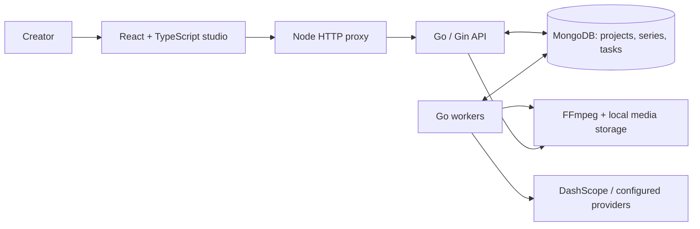

<div align="center">

# LTSeries

**From script to short series. Your AI production studio, self-hosted.**

Turn a script into art direction, reusable characters, storyboards and an assembled video.<br />
Built with **Go · Gin · MongoDB · React**, with real AI provider integrations.

[](https://github.com/eust-w/ltseries/actions/workflows/ci.yml)
[](LICENSE)
[](backend/go.mod)
[](LeriesStudio/package.json)
[](docker-compose.yml)

**English** · [简体中文](README.zh-CN.md)

[Quick Start](#quick-start) · [Features](#what-you-can-create) · [Architecture](#architecture) · [API](docs/frontend-api.md) · [Contributing](CONTRIBUTING.md)

</div>

---

AI video production involves more than generating a clip. Characters need reusable references. Shots need revisions. Failed jobs need a history. The final cut needs all of those pieces to come together.

LTSeries keeps that workflow in one workspace: plan a story, establish its visual language, generate assets, direct individual shots and assemble the result. You bring the script and your provider credentials; the application keeps the projects, assets and tasks on your infrastructure.

> **Project status:** early-stage, self-hosted software for individual creators and trusted teams. The current interface is primarily Chinese. Generation uses paid external APIs; provider access and output quality depend on your account and chosen models.

## A Look Inside


*A real application screenshot. Generation results are not bundled as canned demo data.*

## What You Can Create

| Stage | What LTSeries does |
| --- | --- |
| **Script & episodes** | Edit original scripts, organize series and episodes, and extract characters, scenes, props and shots with an LLM. |
| **Art direction** | Generate and edit visual style, positive/negative prompts, color choices and camera direction. |
| **Asset library** | Manage characters, scenes and props; generate full-body, three-view and headshot variants; select, favorite, upload and lock references. |
| **Storyboard** | Edit shot descriptions, dialogue and prompts; manage asset references; copy, reorder and lock shots; render first frames. |
| **Video production** | Submit image-to-video, reference-to-video or text-to-video jobs where the selected provider/model supports them. Review and select takes. |
| **Assembly** | Complete missing shot media, generate clips in a pipeline, concatenate clips with FFmpeg and preview/download the result. |
| **Task history** | Store progress, failures, results and worker claims in MongoDB, so refreshing the browser does not erase production history. |
| **Readiness checks** | Inspect missing assets, reference records, expiring links and available shot media before delivery. |

Audio, SFX and BGM tasks have backend integration points but require a separately configured `AUDIO_PROVIDER_ENDPOINT`. They are not included as a ready-to-use speech/music service.

### Consistency Is a Workflow

LTSeries supports selected character references, shared art direction, per-shot entity references, video last-frame extraction and reference URL expiry checks. You can regenerate shots against your chosen assets.

These controls improve traceability; they **do not guarantee identical faces, clothing or props** across shots. The production audit scores measure metadata completeness and workflow checks, not visual similarity or measured time savings. A score of 100 is not a visual-quality certification. Review the actual frames before publishing.

For cloud models to use uploaded assets or extracted last frames, their URLs must be reachable by the provider. `localhost` is not a cloud-accessible reference host. See [deployment and media guidance](docs/deployment.md).

## Quick Start

### Docker Compose

Requires Docker with Compose and an Alibaba Cloud Model Studio / DashScope API key with access to the models you intend to use.

```bash
git clone https://github.com/eust-w/ltseries.git
cd ltseries
cp .env.example .env
```

Edit `.env` and set:

- `DASHSCOPE_API_KEY`: your provider key. The LLM key falls back to this key.
- `ADMIN_PASSWORD`: your own login password.
- `AUTH_SESSION_SECRET`: a random secret, for example the output of `openssl rand -hex 32`.

Keep `AUTH_ENABLED=true`. Review the endpoint region and model IDs against the capabilities enabled for your account. The checked-in model catalog is a set of presets, not a guarantee of access.

```bash
docker compose up -d --build
docker compose ps
```

Open **[localhost:3108](http://localhost:3108)** and log in as `admin` with the password you configured. Backend health: [localhost:18080/api/health](http://localhost:18080/api/health).

Compose includes MongoDB, the Go API with FFmpeg, the React application server, and persistent database/media volumes. The database is internal to the Compose network; application ports bind to loopback by default.

### Your First Episode

1. Create a project, paste your script and run analysis.
2. Review the extracted entities, episode plan and art direction.
3. Generate and select character full-body images, then fill in three-views/headshots and scene/prop images.
4. Review the storyboard, correct asset assignments and generate first frames.
5. Generate clips, review individual takes and adjust shots that drift.
6. Assemble the selected clips and download the final video.

Start with a short script and a few shots to validate model access and cost. Each generation request can incur provider charges.

## Local Development

Requires **Go 1.24+**, **Node.js 22.12+**, **Docker** (for MongoDB), and **FFmpeg** on your PATH.

After cloning and configuring the root `.env`:

```bash
./scripts/start-local.sh
```

Start the API in one terminal:

```bash
cd backend
go run ./cmd/server
```

Start the UI in another:

```bash
cd LeriesStudio
npm ci
npm run dev
```

The UI listens on port **3108** and proxies `/api` and `/files` to the API on **18080**. Override the frontend's `PORT` and `BACKEND_URL` through its environment. The backend loads the root `.env`; frontend-only options are documented in [LeriesStudio/.env.example](LeriesStudio/.env.example).

## Architecture



- **One Go backend:** project APIs, authentication, provider orchestration and worker lifecycle.
- **MongoDB-backed queue:** durable jobs and atomic worker claims without a separate Redis service.
- **React studio:** dedicated script, episodes, art, assets, storyboard, assembly and settings pages.
- **Provider configuration:** DashScope for LLM/image/video requests; optional HTTP endpoints for custom asset, video and audio integrations.
- **Local media:** uploads, extracted frames and assembled videos served through `/files`. Provider-hosted outputs may expire; permanent object-storage archival is future work.

```text
ltseries/
├── backend/           Go API, task queue, provider clients and FFmpeg services
├── LeriesStudio/      React studio and Node frontend server
├── docs/              API, feature requirements and production evaluation
├── scripts/           Local development helpers
├── .github/           CI and issue templates
├── .env.example       Configuration template, no credentials
└── docker-compose.yml
```

## Configuration & Models

| Setting | Purpose |
| --- | --- |
| `DASHSCOPE_API_KEY`, `DASHSCOPE_BASE_URL` | Image/video provider credentials and API origin |
| `LLM_BASE_URL`, `LLM_API_KEY`, `LLM_MODEL` | OpenAI-compatible script analysis endpoint; defaults to DashScope/Qwen |
| `DEFAULT_IMAGE_MODEL`, `DEFAULT_VIDEO_MODEL` | Default generation models; project settings can override them |
| `MONGODB_URI`, `MONGODB_DB` | Database connection |
| `TASK_WORKERS`, `TASK_WORKER_POLL_MS` | Worker concurrency and queue polling |
| `STORAGE_DIR`, `PUBLIC_BASE_URL` | Local media location and externally advertised URL |
| `ASSET_PROVIDER_ENDPOINT`, `VIDEO_PROVIDER_ENDPOINT`, `AUDIO_PROVIDER_ENDPOINT` | Optional custom provider integrations |
| `AUTH_ENABLED`, `ADMIN_USERNAME`, `ADMIN_PASSWORD`, `AUTH_SESSION_SECRET` | Single-admin authentication |

Defaults and presets are visible in [.env.example](.env.example) and the [model catalog](backend/internal/services/model_catalog.go). Use the settings page to select models available to your account. Changes to endpoints or process-level configuration may require a backend restart.

## Development Checks

The Go integration tests use a real MongoDB instance. Start it first with `./scripts/start-local.sh`; the default test URL is `mongodb://127.0.0.1:27019`.

```bash
(cd backend && go test ./... && go vet ./...)
(cd LeriesStudio && npm run lint && npm run build && npm audit)
```

CI provisions MongoDB and runs backend tests, type checking and the frontend build. Automated tests do not certify every external model and do not spend provider credits. See [CONTRIBUTING.md](CONTRIBUTING.md).

## Documentation

- [中文说明](README.zh-CN.md)
- [Deployment, media URLs and troubleshooting](docs/deployment.md)
- [Frontend API reference](docs/frontend-api.md)
- [Functional requirements](docs/functional-requirements.md)
- [Production workflow evaluation](docs/production-evaluation.md)
- [LumenX feature mapping](docs/lumenx-feature-parity.md)

## Roadmap

- [ ] Permanent OSS/S3-compatible archival for provider outputs and extracted frames.
- [ ] Human approve/reject states for assets and shots.
- [ ] Stronger character-reference selection and model-specific capability validation.
- [ ] Measured visual-consistency checks, generation costs and latency reporting.
- [ ] Audio-provider presets and a richer editing/mixing workflow.
- [ ] English UI and finer-grained team permissions.

These items are planned directions, not shipped features. Contributions and reproducible bug reports are welcome.

## Contributing

Start with the [contribution guide](CONTRIBUTING.md), [open an issue](https://github.com/eust-w/ltseries/issues/new/choose), or propose a focused pull request. Useful contributions include provider adapters, documentation, deployment tests and creator workflow feedback.

If LTSeries helps your work, a star helps other creators find it.

## License & Acknowledgments

[MIT](LICENSE). Inspired by the production workflow of [Alibaba LumenX](https://github.com/alibaba/lumenx), with a Go/Gin/MongoDB backend and a React workspace. This project is not affiliated with or endorsed by Alibaba. Upstream attribution is preserved in [THIRD_PARTY_NOTICES.md](THIRD_PARTY_NOTICES.md).

Model APIs and generated assets are subject to their providers' terms and any rights in the inputs; the software license does not grant rights to third-party content.
