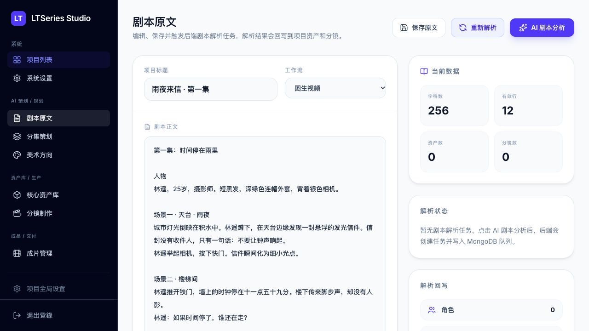
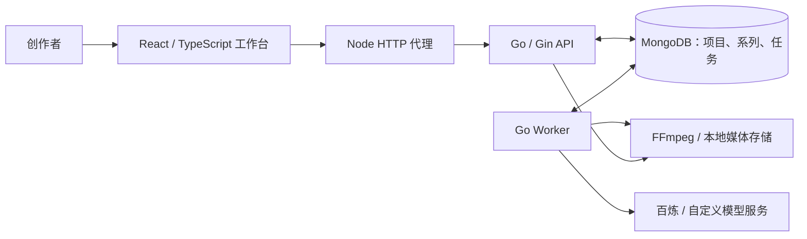

<div align="center">

# LTSeries

**从剧本到成片，自托管的 AI 漫剧与短剧生产工作台。**

Go · Gin · MongoDB · React

[English](README.md) · **简体中文**

[快速开始](#快速开始) · [功能](#可以做什么) · [部署说明](docs/deployment.md) · [API 文档](docs/frontend-api.md) · [参与贡献](CONTRIBUTING.md)

</div>

---

制作 AI 漫剧需要的不只是生成一段视频。角色需要参考图，分镜需要反复调整，任务需要留下记录，最后还要把镜头拼接成片。

LTSeries 将剧本、分集、美术方向、角色资产、分镜视频和成片放在同一个工作空间。你提供故事和模型服务密钥，项目与任务数据保存在自己的基础设施上。

> **当前定位：** 面向个人创作者和可信小团队的早期自托管项目，界面以中文为主。生成能力调用真实外部 API，模型权限、价格和输出质量取决于服务商与所选模型。



## 可以做什么

| 环节 | 已有能力 |
| --- | --- |
| 剧本与分集 | 编辑剧本原文、管理系列与分集、用 LLM 提取角色、场景、道具和分镜 |
| 美术方向 | 自动生成并人工修改视觉风格、正负向提示词、色彩与镜头语言 |
| 资产制作 | 角色全身图、三视图、头像特写；场景与道具图；变体、选择、收藏、上传与锁定 |
| 分镜制作 | 编辑动作、台词和提示词，关联资产，复制、排序、锁定镜头，生成首帧 |
| 视频生成 | 按模型能力使用 I2V、R2V、T2V，预览并选择镜头结果 |
| 成片交付 | 流水线补全镜头媒体、FFmpeg 拼接、成片预览与下载 |
| 任务追踪 | MongoDB 持久化进度、结果与错误，刷新页面后仍可查看 |
| 流程检查 | 检查缺失资产、参考记录、过期链接、首帧、末帧与视频完整性 |

音频、音效、BGM 有后端任务入口，但需要自行配置 `AUDIO_PROVIDER_ENDPOINT`；项目没有内置可直接使用的完整配音或配乐服务。

## 一致性做到哪一步

已支持选择角色参考图、统一美术方向、记录每镜头资产引用、提取视频末帧、检查引用链接有效期，以及按资产重新生成镜头。

**这些机制不能保证百分之百锁脸、锁服装或锁道具。** 生产体检的“效率分”和“一致性分”来自元数据与流程检查，不是实际耗时测量或视觉相似度评测；满分不代表画面质量已通过人工验收。

云端模型必须能够访问参考图地址。`localhost` 上的上传图片和末帧无法直接被百炼读取。正式生产需要可访问的媒体地址，并关注服务商临时链接的过期问题。详见[部署说明](docs/deployment.md)。

## 快速开始

### Docker Compose

准备 Docker / Compose，以及具备对应模型访问权限的阿里云百炼 / DashScope API Key。

```bash
git clone https://github.com/eust-w/ltseries.git
cd ltseries
cp .env.example .env
```

编辑根目录 `.env`：

- `DASHSCOPE_API_KEY`：你的百炼密钥。
- `ADMIN_PASSWORD`：你自己的登录密码。
- `AUTH_SESSION_SECRET`：随机会话密钥，可通过 `openssl rand -hex 32` 生成。
- 保持 `AUTH_ENABLED=true`，并核对账号地域、端点和模型权限。

```bash
docker compose up -d --build
docker compose ps
```

打开 **[localhost:3108](http://localhost:3108)**，使用 `admin` 和配置的密码登录。后端健康检查：[localhost:18080/api/health](http://localhost:18080/api/health)。

Compose 提供 MongoDB、Go API、FFmpeg、React 前端服务和持久化数据卷。默认只将应用端口绑定到本机，不直接开放 MongoDB。

### 第一集的制作顺序

1. 新建项目，输入剧本，执行分析。
2. 检查角色、场景、道具、分集与美术方向。
3. 先生成并选定角色全身图，再补三视图、头像和场景、道具资产。
4. 调整分镜和资产关联，生成并检查首帧。
5. 生成视频，逐镜预览，修改不一致的镜头。
6. 拼接已选视频，检查成片后下载。

先用短剧本和少量镜头验证服务权限与费用。真实生成请求会消耗服务商额度。

## 本地开发

依赖：**Go 1.24+、Node.js 22.12+、Docker、FFmpeg**。

配置根目录 `.env` 后：

```bash
./scripts/start-local.sh
```

终端一启动后端：

```bash
cd backend
go run ./cmd/server
```

终端二启动前端：

```bash
cd LeriesStudio
npm ci
npm run dev
```

前端端口为 `3108`，通过 Node 服务将 `/api` 和 `/files` 转发到 Go 后端 `18080`。AI 密钥只放在根目录后端配置中。

## 架构



- 后端负责业务、认证、模型调用与 Worker。
- MongoDB 同时保存业务数据和任务队列，无需单独部署 Redis。
- 前端按剧本、分集、美术、资产、分镜、成片和设置拆页。
- 原生图像和视频生成走 DashScope；自定义音频等服务通过 HTTP 端点接入。
- 模型目录是预设列表，列出某个模型不等于该账号已获得权限。
- 云端生成结果可能是临时链接；自动永久归档到 OSS/S3 尚未实现。

## 验证与贡献

Go 集成测试需要真实 MongoDB，可先运行 `./scripts/start-local.sh`。

```bash
(cd backend && go test ./... && go vet ./...)
(cd LeriesStudio && npm run lint && npm run build && npm audit)
```

CI 会启动 MongoDB、运行后端测试、前端类型检查和构建。自动化检查不等于所有外部模型已实测通过，也不会自动消耗你的模型额度。

- [参与贡献](CONTRIBUTING.md)
- [前端 API 文档](docs/frontend-api.md)
- [功能要求](docs/functional-requirements.md)
- [生产流程评估](docs/production-evaluation.md)
- [LumenX 功能映射](docs/lumenx-feature-parity.md)

## 后续方向

- [ ] OSS/S3 永久媒体归档。
- [ ] 资产与镜头人工审核、驳回与重生成。
- [ ] 更精细的角色参考组和模型能力校验。
- [ ] 真实视觉一致性、成本与耗时评估。
- [ ] 音频服务预设和更完整的剪辑混音流程。
- [ ] 英文界面和团队权限。

欢迎通过 Issue、PR 或实际创作反馈参与；如果项目对你有帮助，也欢迎 Star。

## 许可证与致谢

采用 [MIT License](LICENSE)。生产工作流受到 [Alibaba LumenX](https://github.com/alibaba/lumenx) 启发；LTSeries 使用 Go/Gin/MongoDB 后端和 React 工作台，与阿里巴巴不存在官方隶属或背书关系。上游许可信息保存在 [THIRD_PARTY_NOTICES.md](THIRD_PARTY_NOTICES.md)。

软件许可不授予第三方素材的使用权；模型服务及生成内容应遵循各自的服务条款。
