<div align="center">

# LTSeries

**从剧本到成片，自托管的 AI 漫剧与短剧生产工作台。**

Go · Gin · MongoDB · React

[](https://github.com/eust-w/ltseries/actions/workflows/ci.yml)
[](LICENSE)
[](docs/deployment.md)

[English](README.md) · **简体中文**

[观看演示](#观看演示) · [工作流导览](#工作流导览) · [快速开始](#快速开始) · [API 文档](docs/frontend-api.md) · [参与贡献](CONTRIBUTING.md)

</div>

---

制作 AI 漫剧需要的不只是生成一段视频。角色需要参考图，分镜需要反复调整，任务需要留下记录，最后还要把镜头拼接成片。

LTSeries 将剧本、分集、美术方向、角色资产、分镜视频和成片放在同一个工作空间。你提供故事和模型服务密钥，项目与任务数据保存在自己的基础设施上。

> **当前定位：** 面向个人创作者和可信小团队的早期自托管项目，界面以中文为主。生成能力调用真实外部 API，模型权限、价格和输出质量取决于服务商与所选模型。

## 观看演示

[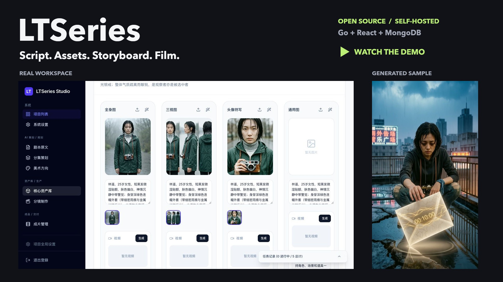](https://github.com/eust-w/ltseries/releases/download/showcase-2026-10/ltseries-landscape-zh.mp4)

**[横屏讲解视频](https://github.com/eust-w/ltseries/releases/download/showcase-2026-10/ltseries-landscape-zh.mp4)** · **[竖屏介绍视频](https://github.com/eust-w/ltseries/releases/download/showcase-2026-10/ltseries-portrait-zh.mp4)** · **[30 秒真实生成样片](https://github.com/eust-w/ltseries/releases/download/showcase-2026-10/ltseries-generated-sample.mp4)**

[中文字幕](https://github.com/eust-w/ltseries/releases/download/showcase-2026-10/ltseries-zh.srt) · [English subtitles](https://github.com/eust-w/ltseries/releases/download/showcase-2026-10/ltseries-en.srt) · [素材来源与复现](docs/media/README.md)

| 工作台速览 | 真实生成片段 |
| :---: | :---: |
| 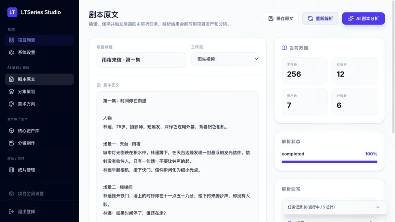 |  |
| 剧本、美术、资产、分镜、任务与设置 | AI 生成画面，仍需检查角色漂移和视觉瑕疵 |

演示为真实界面与实际模型结果的**后期剪辑**，不是实时生成速度测试。解说使用后期合成语音，不代表应用内已内置完整配音能力。成片来自项目历史的六镜头生成记录；新界面截图来自 2026 年 10 月独立演示项目，二者不是同一次完整生成任务。

## 为什么做 LTSeries

**生成一个片段，不等于完成一部短剧。** 真正耗费时间的，是反复整理上下文、找参考图、修分镜、追任务和收集结果。

- **制作上下文集中管理：** 剧本、美术方向、角色参考和镜头属于同一个项目，不必在不同工具间反复拼凑。
- **人始终能介入：** 修改分析结果、选参考、重生成单镜头，保留创作者的决定权。
- **失败也留下记录：** 进度、结果与错误持久化，不是刷新就消失的加载动画。
- **技术栈可理解、可接管：** React + TypeScript 前端，Go + Gin 后端，MongoDB 队列，FFmpeg 拼接，不需要 Python 服务或单独的 Redis。
- **自己部署、自己配模型：** 应用与数据库放在自己的基础设施上；调用云模型时，相关剧本、提示词和参考图仍会发送给模型服务商。

适合 AI 漫剧与短剧创作者、独立影像创作者，以及围绕模型 API 构建工作流的开发者。它不是完整的专业非线性剪辑器，也不承诺百分百角色一致性。

## 工作流导览

```text
剧本 -> 美术方向 -> 参考资产 -> 分镜首帧 -> 镜头视频 -> 拼接交付
                       每一步都能人工检查和修改
```

### 1. 从故事开始，而不是从提示词开始

保留和修改剧本原文，分析后提取角色、场景、道具与分镜；长故事可以通过系列和分集组织。

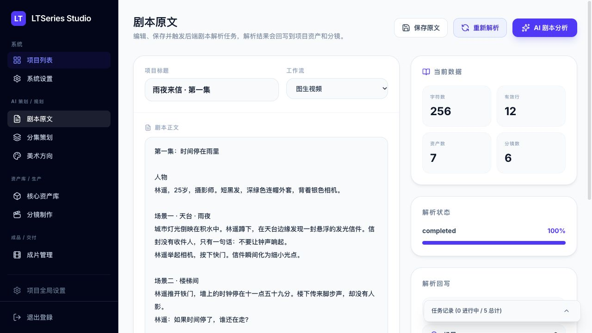

此次演示中，256 字符的中文剧本提取出 **1 个角色、3 个场景、3 个道具、6 个分镜**。这是一次实际运行结果，不是固定数量、速度或质量承诺。

### 2. 先统一视觉语言

查看 AI 推荐或选择预设，继续修改正负向提示词、色彩和摄影备注。先定基调，再批量生产素材。

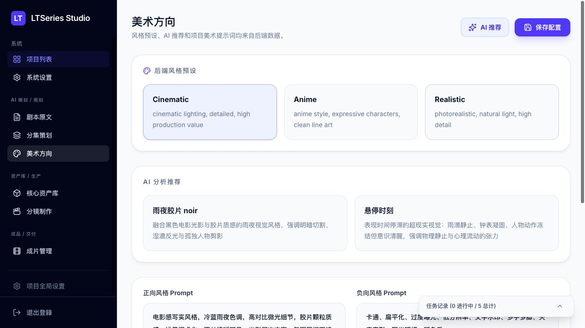

### 3. 角色不是一张临时图片

为角色建立**全身图、三视图、头像特写**；场景与道具独立管理。支持上传、版本选择、收藏和锁定，保留后续镜头可复用的参考资产。

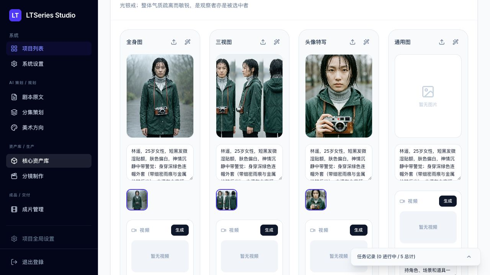

图中为实际模型输出，不是预置图片。生成槽位表示请求的视图类型，仍需人工检查模型是否遵循了构图与角色设定。

### 4. 像导演一样逐镜调整

每镜头可检查动作、镜头语言、对白、场景和提示词。先生成首帧，确认后再生成视频；保留可用版本，单独重做不合适的镜头。I2V、R2V、T2V 是否可用取决于所选模型。

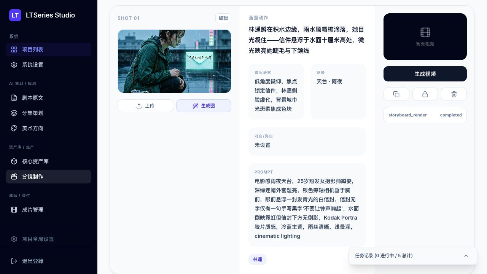

<details>
<summary><strong>展开查看分镜编辑器</strong></summary>

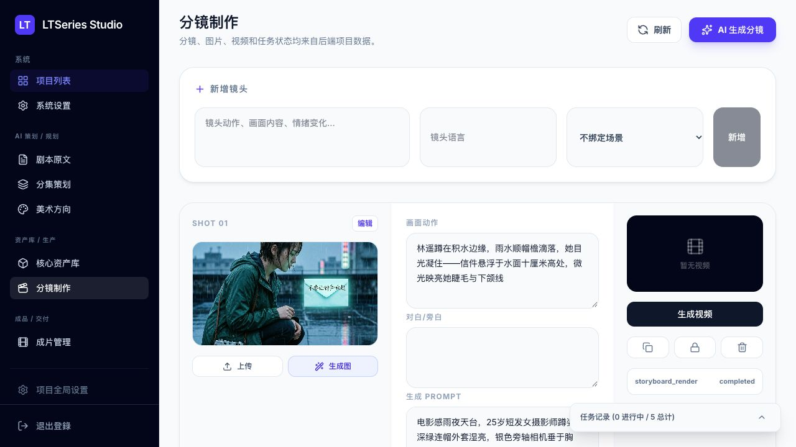

</details>

### 5. 生产状态可追踪，交付前可检查

任务结果和错误保存在 MongoDB；面板可以展开查看，也可以收起以免遮挡画面。成片页检查缺失素材，并通过 FFmpeg 拼接已选镜头。

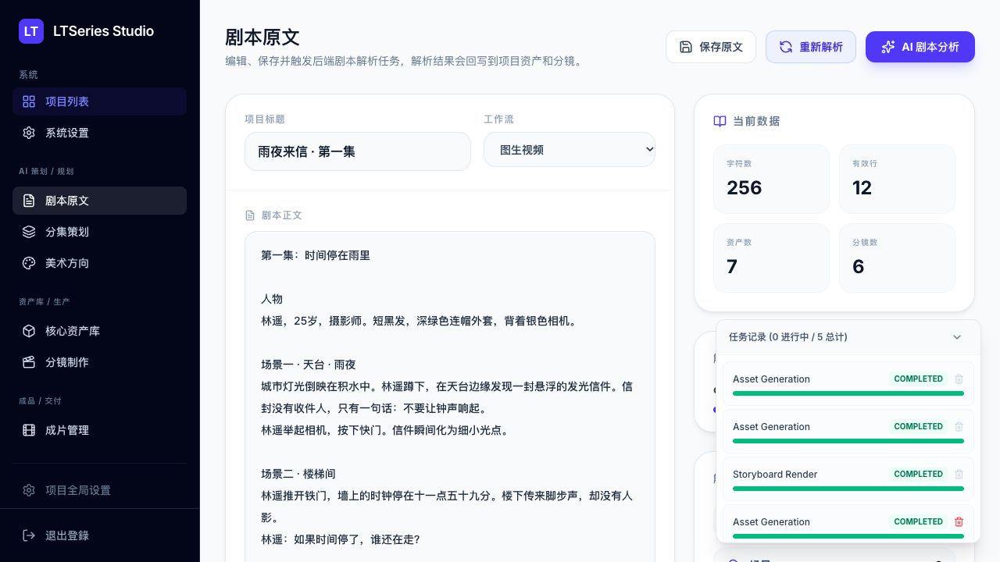

<details>
<summary><strong>更多界面：分集、成片、项目设置</strong></summary>

**分集策划：** 为较长的故事组织系列与集数。

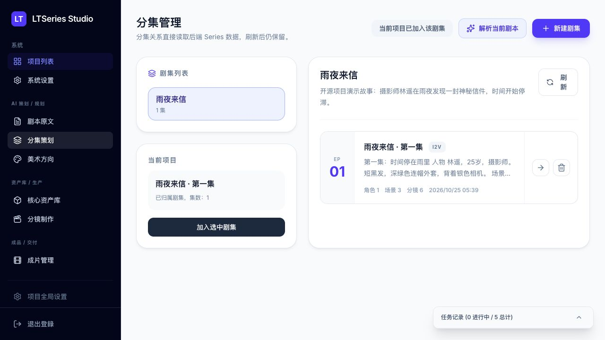

**成片管理：** 查看就绪状态、缺失项和交付操作。图中是尚未补完视频的演示项目，不代表已完成新成片。

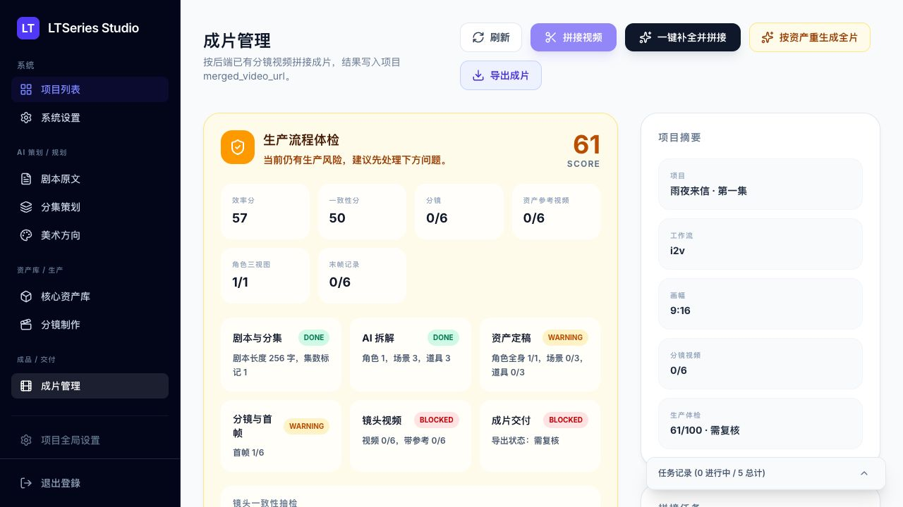

**项目设置：** 选择模型预设与画幅比例。

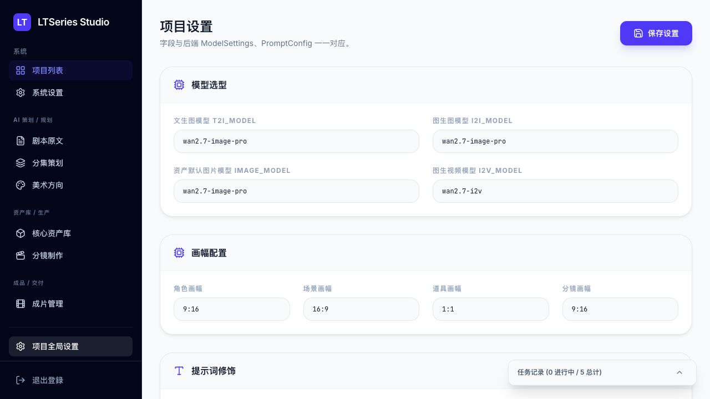

</details>

## 可以做什么

| 环节 | 已有能力 |
| --- | --- |
| 剧本与分集 | 编辑剧本原文、管理系列与分集、用 LLM 提取角色、场景、道具和分镜 |
| 美术方向 | 自动生成并人工修改视觉风格、正负向提示词、色彩与镜头语言 |
| 资产制作 | 角色全身图、三视图、头像特写；场景与道具图；变体、选择、收藏、上传与锁定 |
| 分镜制作 | 编辑动作、台词和提示词，关联资产，复制、排序、锁定镜头，生成首帧 |
| 视频生成 | 按模型能力使用 I2V、R2V、T2V，预览并选择镜头结果 |
| 成片交付 | 流水线补全镜头媒体、FFmpeg 拼接、成片预览与下载 |
| 任务追踪 | MongoDB 持久化进度、结果与错误，刷新页面后仍可查看 |
| 流程检查 | 检查缺失资产、参考记录、过期链接、首帧、末帧与视频完整性 |

音频、音效、BGM 有后端任务入口，但需要自行配置 `AUDIO_PROVIDER_ENDPOINT`；项目没有内置可直接使用的完整配音或配乐服务。

## 一致性做到哪一步

已支持选择角色参考图、统一美术方向、记录每镜头资产引用、提取视频末帧、检查引用链接有效期，以及按资产重新生成镜头。

**这些机制不能保证百分之百锁脸、锁服装或锁道具。** 生产体检的“效率分”和“一致性分”来自元数据与流程检查，不是实际耗时测量或视觉相似度评测；满分不代表画面质量已通过人工验收。

云端模型必须能够访问参考图地址。`localhost` 上的上传图片和末帧无法直接被百炼读取。正式生产需要可访问的媒体地址，并关注服务商临时链接的过期问题。详见[部署说明](docs/deployment.md)。

## 快速开始

### Docker Compose

准备 Docker / Compose，以及具备对应模型访问权限的阿里云百炼 / DashScope API Key。

```bash
git clone https://github.com/eust-w/ltseries.git
cd ltseries
cp .env.example .env
```

编辑根目录 `.env`：

- `DASHSCOPE_API_KEY`：你的百炼密钥。
- `ADMIN_PASSWORD`：你自己的登录密码。
- `AUTH_SESSION_SECRET`：随机会话密钥，可通过 `openssl rand -hex 32` 生成。
- 保持 `AUTH_ENABLED=true`，并核对账号地域、端点和模型权限。

```bash
docker compose up -d --build
docker compose ps
```

打开 **[localhost:3108](http://localhost:3108)**，使用 `admin` 和配置的密码登录。后端健康检查：[localhost:18080/api/health](http://localhost:18080/api/health)。

Compose 提供 MongoDB、Go API、FFmpeg、React 前端服务和持久化数据卷。默认只将应用端口绑定到本机，不直接开放 MongoDB。

### 第一集的制作顺序

1. 新建项目，输入剧本，执行分析。
2. 检查角色、场景、道具、分集与美术方向。
3. 先生成并选定角色全身图，再补三视图、头像和场景、道具资产。
4. 调整分镜和资产关联，生成并检查首帧。
5. 生成视频，逐镜预览，修改不一致的镜头。
6. 拼接已选视频，检查成片后下载。

先用短剧本和少量镜头验证服务权限与费用。真实生成请求会消耗服务商额度。

## 本地开发

依赖：**Go 1.24+、Node.js 22.12+、Docker、FFmpeg**。

配置根目录 `.env` 后：

```bash
./scripts/start-local.sh
```

终端一启动后端：

```bash
cd backend
go run ./cmd/server
```

终端二启动前端：

```bash
cd LeriesStudio
npm ci
npm run dev
```

前端端口为 `3108`，通过 Node 服务将 `/api` 和 `/files` 转发到 Go 后端 `18080`。AI 密钥只放在根目录后端配置中。

## 架构

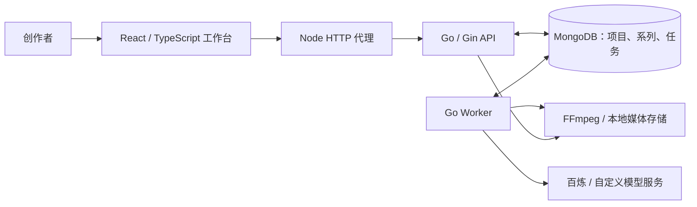

- 后端负责业务、认证、模型调用与 Worker。
- MongoDB 同时保存业务数据和任务队列，无需单独部署 Redis。
- 前端按剧本、分集、美术、资产、分镜、成片和设置拆页。
- 原生图像和视频生成走 DashScope；自定义音频等服务通过 HTTP 端点接入。
- 模型目录是预设列表，列出某个模型不等于该账号已获得权限。
- 云端生成结果可能是临时链接；自动永久归档到 OSS/S3 尚未实现。

## 常见问题

**免费吗？** 软件使用 MIT 许可；模型 API、服务器和存储可能产生费用。项目不提供免费模型额度。

**数据会留在本机吗？** 项目与任务保存在自有数据库，但提交分析和生成时，相关内容会发送给配置的模型服务商。敏感剧本或未获授权的素材应先确认数据政策与使用权。

**能完全锁定角色吗？** 不能。已提供参考、统一风格和引用记录，但模型可能改变脸、服装、道具和空间结构。流程评分也不是视觉质量认证。

**上传本地图片后，云模型能直接用吗？** 只有模型可以访问该媒体 URL 时才行。内网地址、localhost 和过期签名链接都不能充当稳定的云端参考。

**与 LumenX 是什么关系？** 受其工作流程启发，采用 Go/Gin/MongoDB 与 React 实现，不是阿里巴巴官方项目。详见[功能映射](docs/lumenx-feature-parity.md)和[第三方声明](THIRD_PARTY_NOTICES.md)。

## 验证与贡献

Go 集成测试需要真实 MongoDB，可先运行 `./scripts/start-local.sh`。

```bash
(cd backend && go test ./... && go vet ./...)
(cd LeriesStudio && npm run lint && npm run build && npm audit)
```

CI 会启动 MongoDB、运行后端测试、前端类型检查和构建。自动化检查不等于所有外部模型已实测通过，也不会自动消耗你的模型额度。

- [参与贡献](CONTRIBUTING.md)
- [前端 API 文档](docs/frontend-api.md)
- [功能要求](docs/functional-requirements.md)
- [生产流程评估](docs/production-evaluation.md)
- [LumenX 功能映射](docs/lumenx-feature-parity.md)
- [演示素材来源与复现](docs/media/README.md)
- [各平台发布文案](docs/media/publishing-kit.md)

## 后续方向

- [ ] OSS/S3 永久媒体归档。
- [ ] 资产与镜头人工审核、驳回与重生成。
- [ ] 更精细的角色参考组和模型能力校验。
- [ ] 真实视觉一致性、成本与耗时评估。
- [ ] 音频服务预设和更完整的剪辑混音流程。
- [ ] 英文界面和团队权限。

欢迎通过 Issue、PR 或实际创作反馈参与；如果项目对你有帮助，也欢迎 Star。

## 许可证与致谢

采用 [MIT License](LICENSE)。生产工作流受到 [Alibaba LumenX](https://github.com/alibaba/lumenx) 启发；LTSeries 使用 Go/Gin/MongoDB 后端和 React 工作台，与阿里巴巴不存在官方隶属或背书关系。上游许可信息保存在 [THIRD_PARTY_NOTICES.md](THIRD_PARTY_NOTICES.md)。

软件许可不授予第三方素材的使用权；模型服务及生成内容应遵循各自的服务条款。
